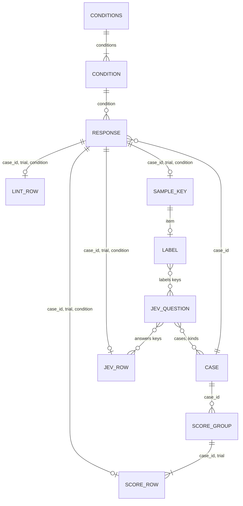

# simple-english data model

The eval data is a set of JSON and JSONL files. The inputs live in
`plugins/simple-english/evals/` and you edit them by hand, but
`calibrate.py score` also rewrites `jev_questions.json`. Each run writes its
rows to `~/.claude/simple-english-evals/<run-id>/`, the folder that
`common.run_dir` returns.

On this page, a stage is one of the 5 scripts of a run: `evals/generate.py`,
`evals/lint.py`, `evals/judge.py`, `evals/jev.py`, and `evals/report.py`.
`evals/calibrate.py` is separate.

## Diagram

SCORE_GROUP has no file of its own. It is the set of score rows that share a
`case_id` and `trial`.

Every run row carries the response key `case_id`, `trial`, and `condition`,
which `common.row_key` returns. A stage appends a new row on a rerun, and
`common.latest` keeps the last row for each key. So the diagram shows at most
1 lint, Jev, or score row for each response, but the file can hold older rows
under the same key.

## Entities

| Entity | File | Lives in | Key fields | Written by | Read by |
| --- | --- | --- | --- | --- | --- |
| CONDITIONS | `conditions.json` | repository | the file itself, with `model`, `effort`, and `conditions` | hand | every stage and `calibrate.py sample`, through `common.load_conditions` |
| CONDITION | an entry in the `conditions` object of `conditions.json` | repository | condition name; the value is a path such as `skills/simple-english/SKILL.md`, or null for the baseline | hand | `common.condition_text` |
| CASE | `cases.jsonl` | repository | `id`; each case also has `kind`, `prompt`, `criteria`, `risk`, and an optional `lint` flag; no script reads `risk` | hand | every stage and `evals/calibrate.py`, through `common.load_cases` |
| RESPONSE | `responses.jsonl` | run folder | `case_id`, `trial`, `condition` | `evals/generate.py` | `evals/lint.py`, `evals/judge.py`, `evals/jev.py`, `evals/report.py`, `evals/calibrate.py` |
| LINT_ROW | `lint.jsonl` | run folder | `case_id`, `trial`, `condition` | `evals/lint.py`, for each case where `lint` is not false | `evals/report.py` |
| SCORE_ROW | `scores.jsonl` | run folder | `case_id`, `trial`, `condition`; also `label`, `group_hash`, `rubric_hash` | `evals/judge.py` | `evals/report.py` |
| SCORE_GROUP | no file; the score rows that share `case_id` and `trial` | run folder | `case_id`, `trial` | `evals/judge.py`, 1 judge request for each group, with up to 2 attempts, and 1 row for each condition in `conditions.json` | `judge.judge_run`; `report.fresh_scores`, which compares each row with `judge.current_group_hashes` |
| JEV_QUESTION | `jev_questions.json` | repository | question name; each question has `question`, `bad_when`, `threshold`, `gating`, and `cases` or `kinds` or both. `threshold` is the cut point for a Jev answer. `bad_when` says if an answer at or above it counts as bad (`yes`) or below it (`no`). `gating` says if the question counts in the gate | hand; `calibrate.py score` rewrites `gating` for each judged question, and `threshold` too when it passes | `evals/jev.py`, `evals/report.py`, `evals/calibrate.py` |
| JEV_ROW | `jev.jsonl` | run folder | `case_id`, `trial`, `condition`; `answers` holds 1 value for each question that applies to the case | `evals/jev.py` | `evals/report.py`, `evals/calibrate.py` |
| SAMPLE_KEY | `sample-key.jsonl` | run folder | `item`; also `case_id`, `trial`, `condition`, `text_hash` | `calibrate.py sample` | `calibrate.py score` |
| LABEL | `labels.jsonl` | run folder | `item`; `labels` holds 1 value for each question that applies: yes, no, or null when blank | `calibrate.py sample` writes it blank, then the user fills it in | `calibrate.py score` |

A Jev question applies to a case when the case `id` is in its `cases` list or
the case `kind` is in its `kinds` list. `jev.applies` makes this check. A
label row has no response key. `calibrate.py score` finds the response through
the `item` in `sample-key.jsonl`.

When `calibrate.py sample` picks at least 1 item, it deletes both files and
writes them again, together with `sheet.md`. So a new sample discards the
labels of the earlier one.

## Hashes

`evals/generate.py`, `evals/lint.py`, `evals/judge.py`, and `evals/jev.py`
store a hash in their rows. On a rerun, each of these 4 scripts skips a row
only when the stored hash equals the current hash. `calibrate.py sample` also
stores a hash, in `sample-key.jsonl`, but it reuses no rows.
`calibrate.py score` uses that hash to find a labeled response whose text
changed. The
[Stale rows](../../../plugins/simple-english/evals/README.md#stale-rows)
section of the eval README lists which edit forces which rerun.

The judge block is the text between the `judge:begin` and `judge:end` markers
in `rubric.md`. `judge.judge_block` cuts it out.

### `input_hash`

The `input_hash` field of a response row holds the value of
`common.response_hash`. That function calls `common.input_hash` on the case
`prompt` and on a system string. The system string holds the `model`, the
`effort`, and the condition text with `NO_TOOLS_NOTE` after it, as
`common.system_text_for` builds it. The hash does not cover the condition name
or the trial.

`common.split_out_of_date` compares the stored hash with the current one.
`evals/lint.py`, `evals/judge.py`, `evals/jev.py`, `evals/report.py`, and
`calibrate.py sample` treat an out-of-date response as missing. A change to a
case prompt, the model, the effort, the body of a condition file
(`common.strip_frontmatter` drops its frontmatter), or `NO_TOOLS_NOTE` makes
`evals/generate.py` regenerate the affected responses. Each later row then
goes stale, because the response text changes.

To rename a condition without new calls:

1. Copy its response rows under the new name. The condition name is not in
   the hash, so they stay current.
2. Copy its lint and Jev rows under the new name too, because `condition` is
   part of their key. If you do not, `evals/lint.py` and `evals/jev.py` make
   new rows for them.
3. Copy its score rows under the new name too, because `condition` is part
   of their key. Even then, if the sort order of the condition names
   changes, `judge.assign_labels` picks new labels, `group_hash` changes, and
   `evals/judge.py` makes a new judge request.

### `text_hash`

3 files store a field named `text_hash`, and each one hashes different
inputs. None of them is a join key. The join is always `case_id`, `trial`,
and `condition`. The hash only tells a script whether the row it has is still
current.

- In `lint.jsonl`, `lint.text_hash` covers the response text, the source of
  `skills/simple-english/scripts/ste_lint.py` (`LINTER_SOURCE`), and the
  source of `evals/lint.py` (`SELF_SOURCE`). A change to either file relints
  every response.
- In `jev.jsonl`, `jev.row_hash` covers the response text, the case `prompt`,
  and the questions that `jev.request_questions` builds for the case. Those
  hold only the question name, the fixed type `noul`, and the `question` text.
  A change to the `question` text, `cases`, or `kinds` makes the affected Jev
  rows stale. A change to `threshold`, `gating`, or `bad_when` makes no Jev
  row stale, so the thresholds that `calibrate.py score` writes need no new
  Jev call.
- In `sample-key.jsonl`, `calibrate.text_hash` covers the response text only.
  If a labeled response is missing, failed, or has new text,
  `calibrate.changed_items` makes `calibrate.py score` stop and write nothing.
  You must run `calibrate.py sample` again and relabel.

`evals/report.py` checks the lint and Jev hashes again in `report.fresh_lint`
and `report.fresh_jev`. It leaves out a stale row and counts it.

### `group_hash`

`judge.group_hash` covers the `model`, the `effort`, `NO_TOOLS_NOTE`, and the
judge prompt that `judge.build_prompt` builds. The prompt holds the judge
block, the case `prompt`, the case `criteria`, the labels, and the response
text of every condition in the group. Each row of a group stores the same
`group_hash`. `judge.judge_run` sends the group to the judge again when any
of its rows is missing, failed, or has a different `group_hash`. A change to
the criteria, the judge block, or any response text in the group makes the
group stale. `report.fresh_scores` leaves out a stale score row.

### `rubric_hash`

`judge.rubric_hash` is the first 16 characters of a SHA-256 of the judge
block. No script uses it to find stale rows, because `group_hash` covers the
judge block already. `report.comparability` uses it: the gate refuses when
the reference and candidate score rows carry different `rubric_hash` values,
or more than 1 value.

## Checked against

The commit is in the "Last checked" section of [README.md](README.md#last-checked).
