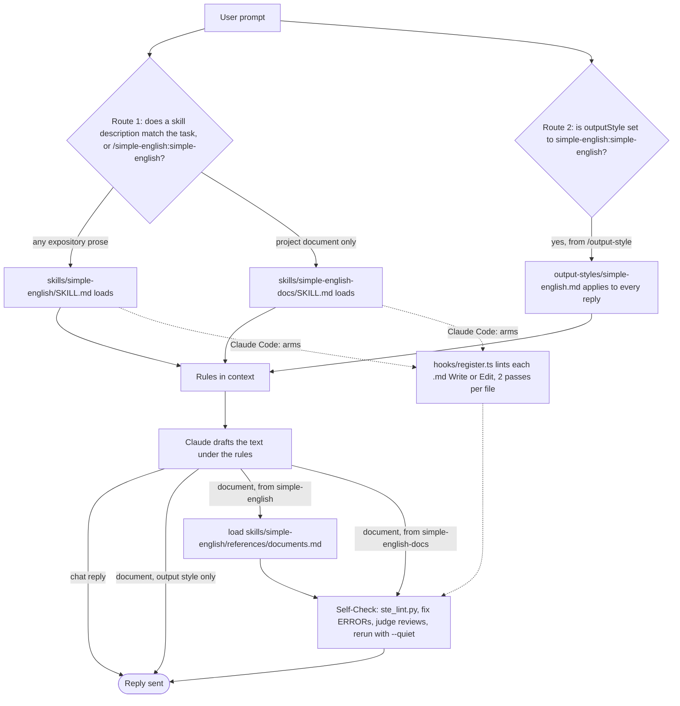
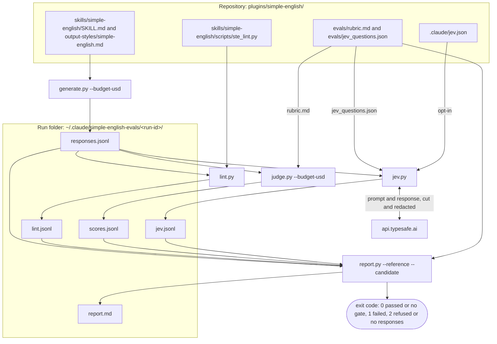
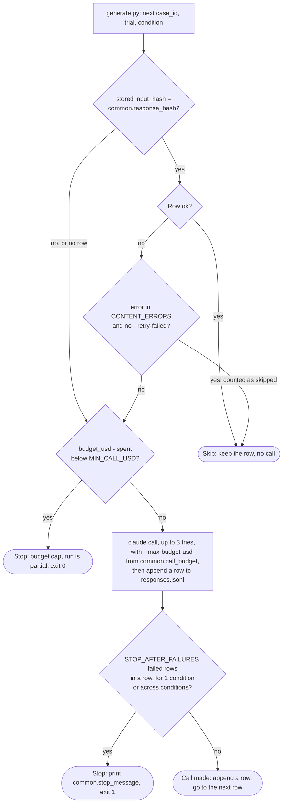
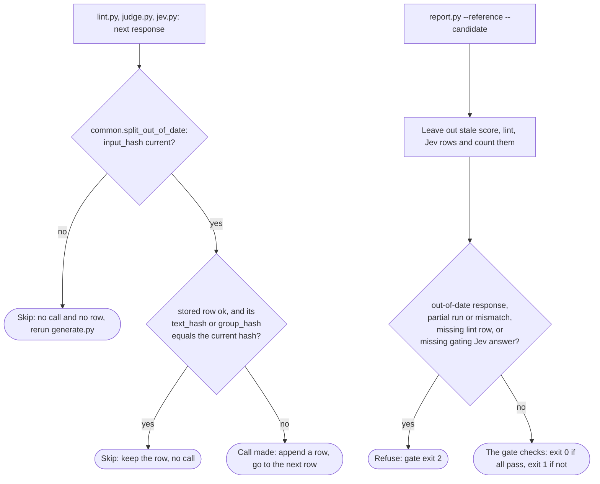
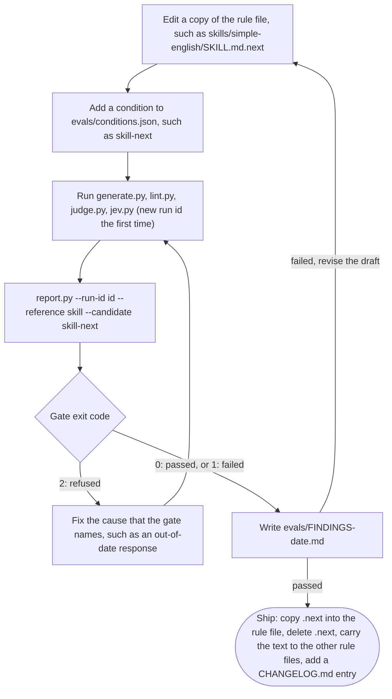
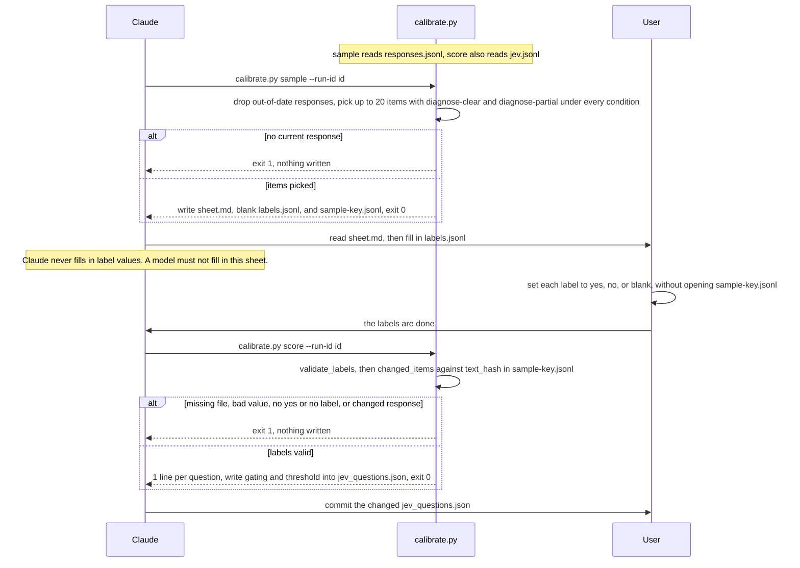

# simple-english workflows

This page holds 6 diagrams in 5 sections: the runtime path that puts the rules in context,
the eval pipeline, row reuse and stale rows, the rule-change cycle, and Jev
calibration. The file and entity names match the
[data model](data-model.md).

## Runtime path

A reply gets the rules by 1 of 2 routes. In route 1, a skill triggers on its
`description`. In route 2, the user selects the output style. Only a document
written under a skill gets a linter pass. A chat reply gets none, and the
output style has no lint step.

The rules live in `skills/simple-english/SKILL.md`,
`skills/simple-english-docs/SKILL.md`, and `output-styles/simple-english.md`.
Each skill carries its own copy of the linter, in
`skills/simple-english/scripts/ste_lint.py` and
`skills/simple-english-docs/scripts/ste_lint.py`. Neither SKILL.md sets
`allowed-tools`.

In Claude Code, `hooks/register.ts` runs the linter without a step from
Claude. A `skill.prompt` hook, or a `tool.call` hook on the `Skill` tool, arms
it when either skill loads. Then a `tool.call` hook on `Write` and `Edit` runs
`skills/simple-english-docs/scripts/ste_lint.py --quiet` on each Markdown file,
at most 2 times per file, and adds the output to the tool result's `context`.
The armed flag and the pass counts live in `$.state`, declared in
`types/index.d.ts`.

## Eval pipeline

5 stages run in order. The first 4 stages append rows to the run folder.
`report.py` rewrites `report.md`.

Every stage reads `evals/cases.jsonl` and `evals/conditions.json`. Every stage
also reads the condition files: `lint.py`, `judge.py`, `jev.py`, and
`report.py` read them through `common.split_out_of_date`, which calls
`common.condition_text`. `generate.py` and `judge.py` read the spend of the
run from `common.spent`, which adds the cost in both `responses.jsonl` and
`scores.jsonl`. The stages are `evals/generate.py`, `evals/lint.py`,
`evals/judge.py`, `evals/jev.py`, and `evals/report.py`. Shared code is in
`evals/common.py`.

## Row reuse and stale rows

A rerun makes a call only for a row that is missing, failed, or out of date.
The first diagram follows `generate.py`. The second follows the later stages
and `report.py`.

`report.py` leaves out the stale rows before the gate runs. So a stale lint
row counts as a missing lint row, and the gate refuses. A stale score row
makes the run partial, and `comparability` refuses.

`generate.py` compares `input_hash` itself. `judge.py` has the same budget
check and the same `STOP_AFTER_FAILURES` stop, with 1 count, but it has no
`--retry-failed` flag: it sends a failed group again on every rerun. `jev.py`
stops after `STOP_AFTER` failures in a row with the same reason from
`STOP_REASONS`. `calibrate.py sample` also leaves out out-of-date responses,
but it keeps no rows: it rewrites its 3 files each time it picks at least 1
item. The code is in
`evals/generate.py`, `evals/judge.py`, `evals/jev.py`, `evals/report.py`, and
`evals/common.py`.

## Rule-change cycle

A rule change runs as a new condition beside the current one. The gate in
`report.py` decides if the new text ships.

The steps are in the "Compare a rule change" and "Results" sections of
`evals/README.md`. The gate rules, `LINT_MARGIN`, and `JEV_MARGIN` are in
`evals/report.py`. The ship step comes from commit `b368a57`. It copied the
cycle 3 draft into `skills/simple-english/SKILL.md`, deleted the draft, and
carried the same text to `output-styles/simple-english.md` and
`skills/simple-english-docs/SKILL.md`. It also added a `CHANGELOG.md` entry.
Both failed gates so far led to a revised draft, so the diagram shows no
other path.

## Jev calibration

`calibrate.py` has 2 subcommands, `sample` and `score`. The user labels the
sheet between them.

The code is in `evals/calibrate.py`: `write_sample` for `sample`, and
`validate_labels`, `changed_items`, `score`, and `apply` for `score`. A
question passes at `PASS_AGREEMENT` agreement with at least `MIN_EACH` "yes"
and `MIN_EACH` "no" labels. The steps are in the "Calibrate Jev" section of
`evals/README.md`.
